# TAPython

Build Unreal Editor tools as easily as possible with Python.

[TAPython website](https://www.tacolor.xyz/pages/TAPython.html)

[TAPython documentation](https://www.tacolor.xyz/tapython/welcome_to_tapython.html)

## Overview

TAPython is an Unreal Engine editor plugin for building Python-powered editor tools. It lets you create menus and native Slate UIs dynamically, iterate on UI changes without recompiling or restarting the editor, and use 300+ extended APIs for assets, materials, landscapes, viewports, and editor automation.

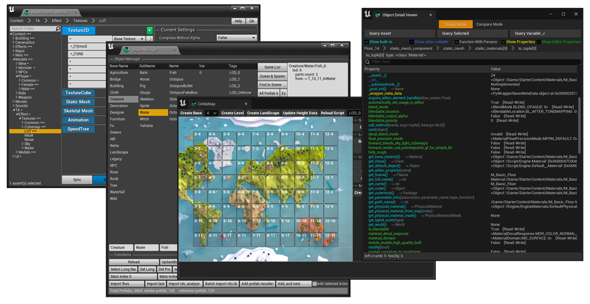

Thanks to all TAPython stargazers!

[](https://star-history.dera.page/#cgerchenhp/UE_TAPython_Plugin_Release&Date)

## What's New

### v1.3.3

- Supports Unreal Engine 5.8.
- Adds viewport-stat inspection and editor screenshot capture, including Slate/UI overlays.
- Adds active-world queries for Editor, PIE, and Simulate modes, plus actor queries for Editor and PIE.
- Fixes inaccurate viewport-stat unit data and the `get_world` deprecation warning.

See the [full release history](CHANGELOG.md).

## Editor Modes: interactive viewport tools without C++

Create custom Editor Modes with **JSON-defined UI and Python logic**. No C++ is required, and live hot reloading lets you iterate quickly. Handle mouse and keyboard input, add viewport-overlay UI, and build interactive painting, sculpting, placement, and similar workflows.

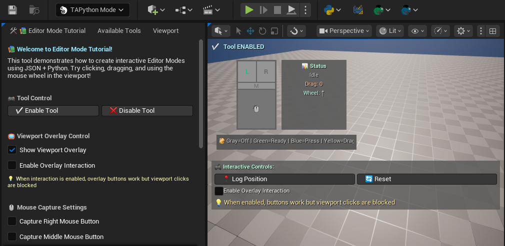

[Learn how to create Editor Modes with TAPython](https://www.tacolor.xyz/Howto/create_editor_modes_with_tapython.html).

## Features

- Use Unreal Engine's built-in Python integration across supported UE4 and UE5 releases.
- Create native Slate UIs dynamically, with support for 43+ widget types.
- Configure Main Menu, toolbar, and Content Browser context-menu entries.
- Define Slate-like interfaces in JSON and preview UI changes in real time without reloading.
- Bind Python commands to Slate widgets and update UI content from Python.
- No engine-source modifications are required. This release supports UE 5.8; see the [release history](CHANGELOG.md) for version-specific compatibility.
- Use 300+ extended Editor APIs for assets, materials, landscapes, viewports, and editor automation.

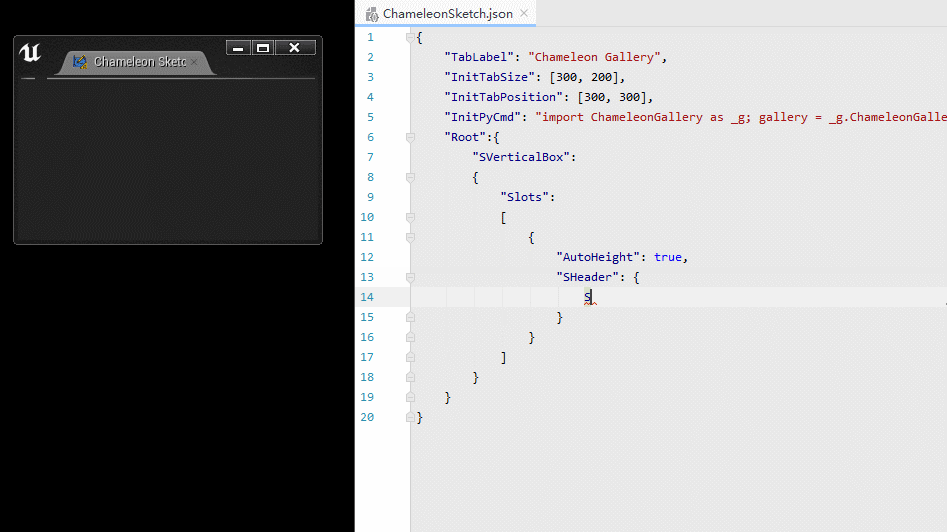

## How to Install

### Prerequisites

TAPython relies on Unreal Engine's built-in **Python Editor Script Plugin**. Enable it for your project, then refer to Epic's [Scripting the Unreal Editor Using Python](https://dev.epicgames.com/documentation/en-us/unreal-engine/scripting-the-unreal-editor-using-python) guide.

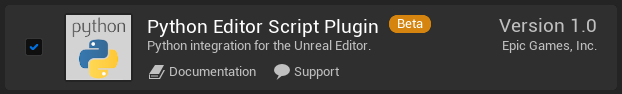

### Steps

1. Download the TAPython release that matches your Unreal Engine version from [GitHub Releases](https://github.com/cgerchenhp/UE_TAPython_Plugin_Release/releases), then extract the `TAPython` folder into `<Your_UE_Project>\Plugins`.
   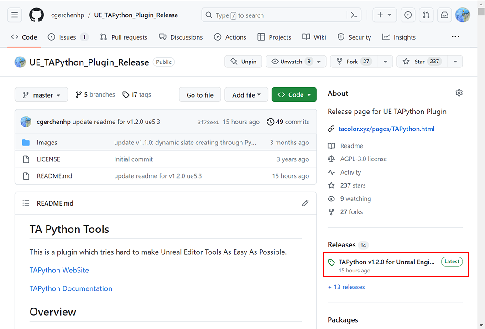

```
    Your_UE_Project
    ├── Content
    ├── ...
    └── Plugins
        └── TAPython       # Place the plug-in here
            ├── Binaries
            ├── Config
            └── Content
            └─ ...
```

2. Launch the project. By default, if `<Your_UE_Project>\TA` does not already exist, TAPython copies its initial resources there on the first launch. Open **Edit > Project Settings > Plugins > Python**, add `<Your_UE_Project>\TA\TAPython\Python` under **Additional Paths**, and then restart the editor.

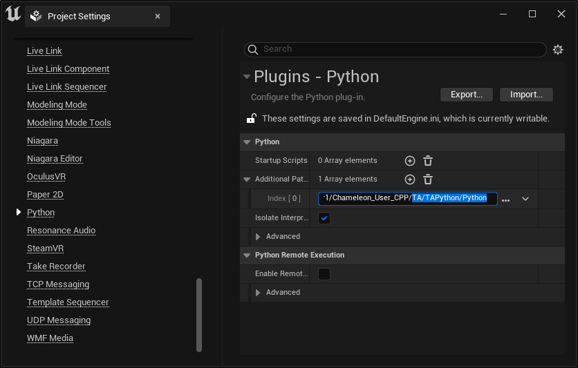

3. Click the **Gallery** icon in the main toolbar. You should see a green check mark, as shown below.

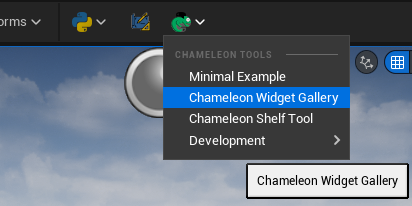

A green check mark and the text **Python Path Ready** appear at the top of the Gallery.

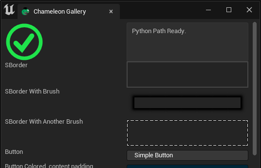

If a red cross is displayed, check the Project Settings entry above.

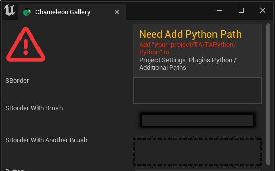

## Quick Start

The plug-in package includes several menu items and four example tools.

The source repository for the default resources is [TAPython DefaultResources](https://github.com/cgerchenhp/TAPython_DefaultResources).

### Menu Items

- Content Browser context-menu entries
- Context-menu entries for selected assets
- Main-menu entries
- Toolbar icons

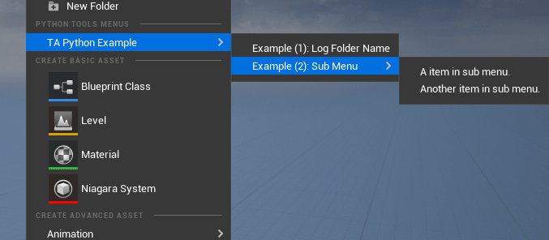

### Sketch Tool for designing and refining UIs

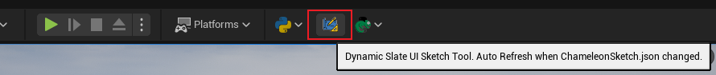

The **Sketch Tool** is a live UI-design tool. When you save changes to `<Your_UE_Project>\TA\TAPython\Python\ChameleonSketch\ChameleonSketch.json`, its UI updates immediately (see the GIF below). Use it to rapidly prototype tool interfaces and refine their layout and parameters.


The default Sketch Tool is shown below. Edit `ChameleonSketch.json` in any text editor and save it to see your changes. The JSON syntax is straightforward, and the examples below provide a useful starting point.

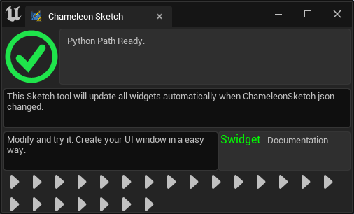

---

### Example Tools

All four example tools are written entirely in Python, without a single line of C++ code.

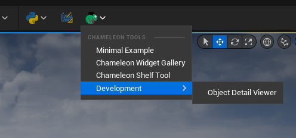

#### Tool 1: MinimalExample

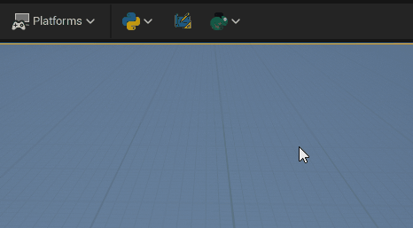

This tool demonstrates how to create a native Slate UI from a JSON file and Python code. Clicking the button invokes Python, which sends the click count back to the UI.

The example consists of a 30-line JSON file and a 15-line Python file, and it can be made even smaller.

Tools built this way are called **Chameleon Tools**.

`MinimalExample.json`

```
    {
        "TabLabel": "Example",
        "InitTabSize": [200, 123],
        "InitTabPosition": [680, 150],
        "InitPyCmd": "import Example; chameleon_example = Example.MinimalExample.MinimalExample(%JsonPath)",
        "Root":
        {
            "SVerticalBox":
            {
                "Slots": [
                    {
                        "SButton": {
                            "Text": "Click Me",
                            "HAlign": "Center",
                            "VAlign": "Center",
                            "OnClick": "chameleon_example.on_button_click()"
                        }
                    },
                    {
                        "SEditableTextBox":
                        {
                            "IsReadOnly": true,
                            "Aka": "InfoOutput",
                            "Text": ""
                        }
                    }
                ]
            }
        }
    }
```

`MinimalExample.py`

```
    # -*- coding: utf-8 -*-
    import unreal
    from Utilities.Utils import Singleton


    class MinimalExample(metaclass=Singleton):
        def __init__(self, jsonPath:str):
            self.jsonPath = jsonPath
            self.data = unreal.PythonBPLib.get_chameleon_data(self.jsonPath)
            self.ui_output = "InfoOutput"
            self.clickCount = 0

        def on_button_click(self):
            self.clickCount += 1
            self.data.set_text(self.ui_output, "Clicked {} time(s)".format(self.clickCount))
```

---

#### Tool 2: Shelf

Shelf is a Maya-style shortcut shelf. It demonstrates changing widget visibility and using `SDropTarget`.

Users can drag items onto the shelf, then click an item to run custom Python code or open a Chameleon Tool.

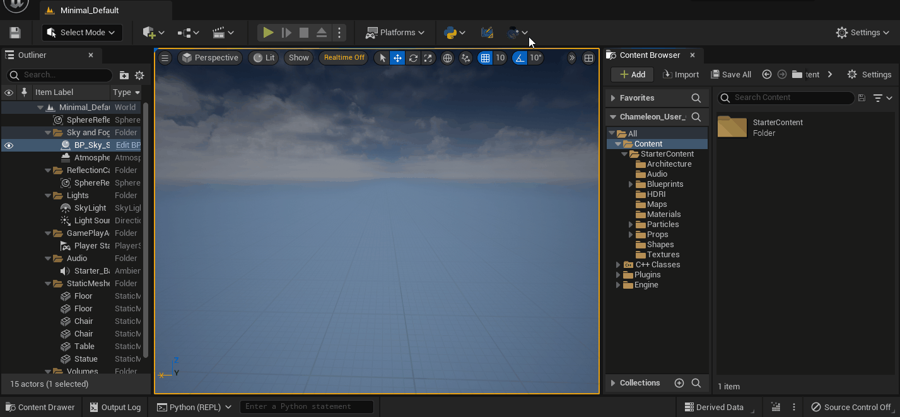

| Item type | Action |
| --- | --- |
| Assets | Select the saved assets in the Content Browser. |
| Folder | Open the saved folder in the Content Browser. |
| Actors | Select the saved actors in the level. |
| Text (Python snippet) | Run it as Python code. |
| Chameleon Tool JSON file | Launch the Chameleon Tool. |

You can customize the Python code to fit your workflow.

---

#### Tool 3: Object Detail Viewer

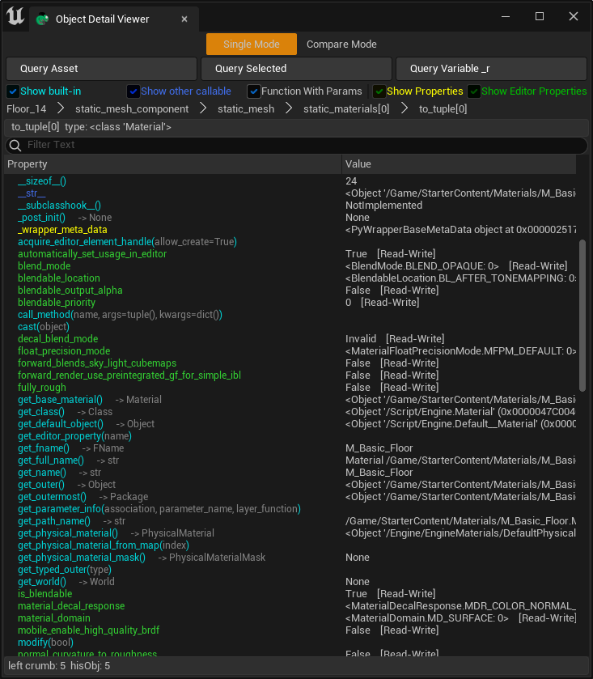

Object Detail Viewer is an inspector for Unreal Engine objects. It shows the functions and properties of any `UObject`. Double-click a property to inspect its child properties. The screenshot above shows the value of `Floor_14(actor).static_mesh_component.static_mesh.static_materials[0]`.

In comparison mode, differences between two `UObject`s are highlighted. This is useful for exploring unfamiliar Unreal object types.

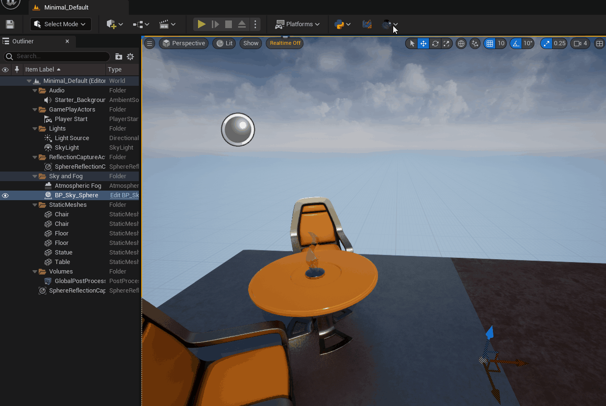

#### Tool 4: Chameleon Gallery

Chameleon Gallery demonstrates common Slate widgets and their JSON descriptions. See the [Chameleon Gallery](https://www.tacolor.xyz/tapython/chameleon_gallery.html) for supported widgets and API documentation.

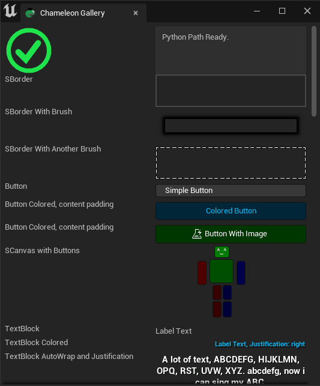

## Documentation

See the [TAPython documentation](https://www.tacolor.xyz/tapython/welcome_to_tapython.html) for tutorials, setup guidance, and API references.

## FAQ

### Q. Does TAPython support UE4?

**A:** Yes. TAPython was first developed for UE 4.21, and historical releases are available for UE 4.26 and 4.27. This release supports UE 5.8; choose the release that matches your engine version.

### [More FAQs](https://www.tacolor.xyz/pages/TAPython.html#faq)

## Links

- [How-to guides](https://www.tacolor.xyz/category/howto.html)
- [Chameleon Gallery](https://www.tacolor.xyz/tapython/chameleon_gallery.html)
- [ChameleonData API](https://www.tacolor.xyz/pages/ChameleonDataAPI.html)
- [Supported Slate widgets](https://www.tacolor.xyz/pages/SupportedSlates.html)
- [Extended Python API](https://www.tacolor.xyz/pages/PythonEditorLib.html)

## Contributing and feedback

TAPython is free software licensed under the [GNU Affero General Public License v3.0](LICENSE). The separately distributed [TAPython DefaultResources](https://github.com/cgerchenhp/TAPython_DefaultResources) are licensed under the MIT License.

- Suggestions and feedback are welcome.
- If you encounter a problem, [email the maintainer](mailto:chpsemail@gmail.com) with a clear description, screenshots, and relevant log output.
- Please also report unclear wording or documentation errors.
